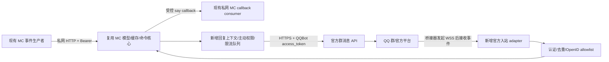

# 官方 QQ 群 Bot 平台边界与最小迁移架构

检索日期：2026-11-10（UTC）。本报告基于匿名可访问的 QQ 官方文档及本地 README/src 静态阅读；未登录管理端、申请账号、部署、读取真实凭据或进行真实 QQ 消息测试。文中的“平台已文档化”不等于本应用已获权限或已实测。所有配置和接口设计均为建议，**当前程序不能直接加载这些新增配置**。

## 1. 决策与可交付边界

推荐在现有 Python/FastAPI 项目内增加独立官方 QQ adapter，保留 Minecraft webhook、状态缓存、显式命令白名单。首期采用桥接器主动连接 QQ 官方 Gateway 的 WebSocket 客户端模式，出站使用官方 HTTPS API；本机 MC webhook 与管理接口继续限于私网。官方当前明确支持 WebSocket/Webhook 切换，WebSocket 不要求部署公网回调服务器。[1]

首期产品范围建议：一个测试群，`@机器人 /mc players`、`@机器人 /mc status`，按需开放受控 `/mc say`。随后分别验证主动 MC 通知和全量群消息。官方已有全量群消息事件，并非永远只能接收 @；但需要群主开启相应权限，不能把它写成默认能力。[4][7][13]

MC 聊天、上线、下线、死亡产生时通常没有 QQ 用户触发消息，属于主动群消息场景。官方文档允许主动群消息，群主可授权主动推送，但仍有开关、权限、频率和每日额度限制；因此“完全不能主动通知”与“可无限转发”都不成立。[2][3][13]

**当前仓库仍只有 OneBot v11 adapter，没有官方 QQ adapter。此次仅交付研究与设计，不宣称迁移、Hermes 联调或群服互通完成。**

## 2. 官方证据表与资料取舍

下面引号中的短句摘自本次读取的正文；精确 URL 由文末 Sources 给出。所有来源检索日期均为 2026-11-10。外部事实以对应场景的专门页面为主，不把频道规则推广到 QQ 群。

| 来源 | 关键原文依据 | 本文用途/限制 |
|---|---|---|
| 接入指南[1] | “支持WebSocket、WebHook回调连接方式灵活切换”；“个人认证：暂不支持公开使用” | 当前管理端与主体/服务范围；未核实本账号实际状态 |
| 官方 FAQ[13] | “管理员账号可直接测试使用，无需沙箱环境”；“旧版管理端目前已停止审核上架、功能配置等” | 避免沿用旧沙箱与上架教程 |
| 官方 FAQ[13] | “当群主设定允许该机器人接收群内全部消息时”；“设置主动推送消息能力” | 群主授权决定全量接收和主动发送 |
| 群 @ 事件[4] | “content 字段已自动去除@机器人的前缀” | 官方入站消息解析 |
| 全量群消息[7] | “当机器人开启了\"接收所有消息\"功能后” | 存在 GROUP_MESSAGE_CREATE，但有开启前提 |
| 消息概述[2] | 群聊“5 分钟”“5 次”；个人/企业群主动“60/qpm” | 被动窗口、主动额度，不引用频道每日限制 |
| 发送群聊消息[3] | “msg_id + msg_seq 重复发送会失败”；event_id“与 msg_id 二选一” | 回复上下文、去重及错误码 |
| 凭证[10] | “即使调用失败，HTTP 返回码仍为 `200`”；“目前是 7200 秒之内的值” | 必须检查业务 code、按返回 TTL 刷新 |
| API 指南[11] | “不同的 `bot(AppID)` 获取到的用户 `openid`，群 `openid`，频道 `openid` 均不相同” | 身份命名空间，不能直接沿用数字 ID |
| Webhook[8] | “开发者需要提供一个 HTTPS 回调地址”；允许端口“80、443、8080、8443” | HTTP 方案的部署前提和地址挑战 |
| 安全授权[9] | “每一次回调请求”；“目前签名算法使用Ed25519” | 不能复用 OneBot HMAC-SHA1 |
| 通用 Payload[6] | `id` 为事件 id；`s` 为序列号；Opcode 12 为 HTTP Callback ACK | 分离事件 ID、消息 ID 和连接序号 |
| WebSocket[16] | “第一步先调用”获取 WSS 接入点；“及最大并发限制” | Gateway 发现、心跳、恢复和连接限制 |
| 启动接入[12] | “Token 的鉴权方式已废弃” | 不照抄旧静态 Bot Token 教程 |

资料内部存在新旧结构并存：通用 Intents 列表仍主要列出 GROUP_AT_MESSAGE_CREATE，而专门事件页和消息概述已列 GROUP_MESSAGE_CREATE。[2][6][7] 采用专门事件页确认“文档存在此能力”，用管理端授权与真实事件测试确认可用性；不据一个未列出的事件推断平台不支持，也不据文档示例推断所有账号自动开通。

本次 WebSocket 页面正文提取不完整，搜索结果补充了 Identify/Resume 描述；因此实现前仍须核对最新官方 SDK 的 Identify token 格式和恢复行为。本文只明确 HTTP 鉴权为 `QQBot ACCESS_TOKEN`，不把旧 `Bot {appid}.{app_token}` 当成可直接使用的当前实现规范。[10][12][16]

## 3. 账号、机器人类型、测试及发布

1. 入口是 QQ 开放平台的机器人管理端；可通过 QQ 或邮箱注册，按主体类型完成认证、绑定管理员，再创建机器人、填写头像昵称简介。原创机器人可跳过可选 AI 服务连接。[1]
2. 选择具备 **QQ 群服务范围** 的官方机器人应用。QQ 群、单聊和频道虽在同一产品体系中，但接口与事件不同；本项目使用 `/v2/groups/...`、GROUP_AND_C2C_EVENT 相关群事件，不使用频道 `/channels/...` 替代群聊，也不把公域/私域频道 Intents 当群全量权限。[2][3][6]
3. 当前指南列出：未认证创建者仅可添加自己是群主/管理员的群；个人认证暂不支持公开使用、进群上限 500；企业认证可设置公开服务范围，旧版已公开的个人机器人有历史例外。FAQ 进一步说明个人主体通过最新版移动 QQ 添加自己管理的群。[1][13] 这些是公开资料规则，不代表用户已经具备创建资格；FAQ 对创建失败还要求检查认证和超级管理员身份。[13]
4. 当前 FAQ 明确管理员可直接测试，无需沙箱，旧版不再添加沙箱群/频道配置；指南列“内部体验号码”最多 20 个。不能要求用户必须找到旧沙箱群入口，也不能把体验用户名额等同于群权限或可公开发布。[1][13]
5. 入群由创建者/有权限人员在最新版移动 QQ 操作，FAQ 建议扫码添加；群主在“设置权限”中授权接收全量群消息及主动发言。应用通过接收事件获取 group_openid，再由操作者在本地批准映射，不提供任意数字群号强行入群流程。[13][4]
6. 当前指南称服务范围可免审核切换，FAQ 称旧版审核入口停用；这不等于免除主体资质、资料规范、服务范围控制或运营责任。企业公开服务具体对本应用展示的流程、审核时长、特殊权限审批以及资质结果，**未登录核实，不给出固定天数或保证通过**。[1][13]

待运营者自行完成并留非敏感记录：主体类型/认证状态、AppID、群服务范围、群内机器人已加入、全量/主动权限开关、体验用户范围、出口 IP 白名单。指南目前只支持单个 IPv4 白名单、不支持 CIDR；应填实际 API 出口地址，不能直接把内网地址当出口。[1]

## 4. 能力矩阵

| 功能 | 平台边界 | 仓库现状 | 推荐落地/降级 |
|---|---|---|---|
| @ 查询玩家/状态 | GROUP_AT_MESSAGE_CREATE；群被动回复窗口及次数受限[3][4] | OneBot 查询与缓存已实现 | 首期实现官方归一化与 reply context，回复标明缓存时效 |
| 不 @ 的群消息 | 开启接收所有消息后有 GROUP_MESSAGE_CREATE[7][13] | 仅接受 OneBot group message + `/mc` | 默认关闭，授权及实测后启用；无权限时明确要求 @ |
| QQ→MC 说话 | 平台接收到事件后仍需应用路由 | `say` callback 已实现但默认关闭 | 保持显式 `/mc say`，不要自动把全群发言送进游戏 |
| MC 聊天即时转群 | 属主动消息，需主动推送权限，受频控[2][3][13] | 每条事件同步调用 OneBot | 默认不启用全量转发；授权后使用有界队列、合并与丢弃策略 |
| MC 上下线/死亡 | 与聊天相同，不是 QQ 入群事件[3][13] | 格式化及四类通知开关已实现 | 单独开关，优先聚合通知；权限不足退化为用户主动查询 |
| 用 event_id 回复 | 仅支持列明的事件类型；不可任意借用[3] | 未实现 | 只用于该事件的关联回复，不作为长期通知凭证 |
| 绑定/白名单 | 本文不确认任何平台自动绑定能力 | 尚无账号绑定 | 后续双端一次性挑战码，使用 MC UUID，不依赖昵称或 QQ 数字号 |
| Hermes admin | QQ 官方身份认证不等于授权执行 agent | 已有显式 HTTP adapter 和整数 admin allowlist | 迁移首期强制关闭；身份授权重做后另行验收 |
| 图片/语音/富媒体 | 官方有专用消息结构和上传流程[2][3][7] | 当前主要文本协议 | 首期只支持纯文本；不下载附件、不解析引用消息内嵌命令 |

## 5. 事件接收与鉴权

### 5.1 推荐 WebSocket 路径

桥接器作为 **客户端** 从官方 API 获取 Gateway 地址并建立 WSS；处理 Hello 后按下发 heartbeat_interval 心跳，保存 session_id 和已处理的连接序列 s，断线先尝试 Resume，失效后重新 Identify。分片、会话启动及并发限制使用 Gateway 返回值，不照抄示例常量。[6][16]

这与现有 OneBot 反向 WebSocket 服务端方向相反：不能把 QQ 官方连接地址填入 ONEBOT_API_URL 或复用 `/api/v1/onebot/ws`。当前 OneBot 的 action/echo/retcode 也不等于官方 op/t/d/s/id Payload（本地 `main.py`、`onebot.py` 与官方结构对照）。[6]

此方案保留本机桥接监听于 127.0.0.1；Docker 内按网络实际地址连 MC callback。API 出站仍通过 HTTPS，群出站目标固定为 `https://api.bot.qq.com/v2/groups/{group_openid}/messages`。[3][11] 只启用当前应用有权限且业务需要的群事件；通用文档提示无权限 Intents 可导致连接关闭。[6]

### 5.2 HTTP callback 备选路径

需要部署公开 HTTPS callback。官方列允许端口 80/443/8080/8443；这里是 **公网 URL 的端口**，不是反代后端的内网监听端口。[8] 本报告未测试现有公网映射能否满足该要求，不能据本机存在 TLS 服务认定可用。

建议独立 `/api/v1/qq-official/events`（未实现），与 OneBot endpoint 分开：

- 地址验证使用 Opcode 13，读取 `d.event_ts`、`d.plain_token`，按官方示例用 Bot Secret 派生 Ed25519 密钥，对 `event_ts + plain_token` 签名，返回 plain_token/signature。[8]
- 每次事件请求取 `X-Signature-Ed25519`、`X-Signature-Timestamp`，验证 **时间戳字符串 + 原始请求体字节**；不能先 JSON 重排再验签。Secret 重复补足/截取 32 字节种子的细节按官方算法执行，不改成 HMAC。[9]
- 建议新增 AppID 匹配、原始 body 大小限制、时间戳合理性检查、事件去重和持久化收件箱，入箱成功后按 HTTP Callback ACK 协议应答；业务投递失败不应导致无限重放执行。[6][9] 地址挑战的验签/处理须按平台实际请求形态单独测试，不将一般业务事件分支生硬套用到挑战。
- **重放策略是应用设计**：签名只证明内容与签名匹配，不能代替去重。建议以 `(AppID, event type, event id)` 和消息 ID 建唯一键，HTTP 重复请求仍正常确认，但不再次执行 callback/Hermes。允许的时钟偏差、去重保留期和迟到事件处理应结合实测重试行为配置；本次官方页面未核实固定重试间隔、重试次数、ACK 截止时间或强制时间戳容差，不编造数值。

### 5.3 access_token 生命周期

POST `https://api.bot.qq.com/app/getAppAccessToken`，JSON 字段为 `appId`、`clientSecret`，API 使用 `Authorization: QQBot ACCESS_TOKEN`；旧静态 Token 鉴权已废弃。[10][12]

官方给出的默认生命周期为 7200 秒，但返回有效时间可能在 7200 秒以内，示例 expires_in 是字符串而表格为 number；实现需接受合法数字字符串/数字，以实际返回值计算到期。有效期内重复获取通常返回相同 token，临近到期 60 秒内可获得新 token，旧 token 在该 60 秒仍有效。[10]

建议增加带锁 token manager、后台刷新和短 TTL 处理；不要多 worker 同时刷新形成请求风暴。凭证接口 HTTP 200 仍可能返回业务 code，必须检查 access_token/expires_in 或失败 code。Secret/token 不进入日志、状态页或仓库。[10] 本文不声称已有 token manager 或可用凭据。

## 6. 消息上下文、限频与失败语义

- `msg_id` 来自群消息事件 `d.id`，用于被动回复；群有效期 5 分钟，每条消息最多回复 5 次。`msg_seq` 默认 1，同 msg_id + msg_seq 重复发送失败；多次有效回复需递增序号，不能递增绕过回复次数上限。[3]
- `event_id` 来自最外层事件 id，与 msg_id 二选一。发送群消息页列出的支持事件为 INTERACTION_CREATE、GROUP_ADD_ROBOT、GROUP_MSG_RECEIVE；不能把任意事件（特别是 MC join/death）伪造为 event_id。event_id 的具体有效期本次未核实；应按事件专门规则和实际错误处理，不能推定永远有效。[3]
- 顶层 `s` 是连接序列，用于心跳/恢复；不是出站 msg_seq，也不是消息 ID。[6]
- 当前群主动额度：企业认证/个人认证 Bot 维度 60/qpm，未认证 30/qpm；单关系 20/qpm、每日 1000 条/群。发送接口同时标注 100 QPS，后者不覆盖更严格的主动消息约束，不能用它承诺通知吞吐。[2][3]
- 群主动开关可以关闭，禁言、移群、无权限、内容违规和频控都可能令发送失败；无用户触发通知只有在群内授权及实际 API 成功时才算平台接收，仍非用户已读。[2][3][13]

建议独立出站策略层：每应用与每群限流、每日额度账本、有界队列和通知合并；具体上线限额取低于已验证上限的运维配置。被动消息到期丢弃并计数，**禁止自动转换成主动消息**；无主动权限则保存本地有限摘要供下次 `/mc status` 查询，不持续刷重试。

错误应分开记录 `accepted`（业务接受）、`queued`（持久排队）、`platform_accepted`（API 业务成功）、`failed/expired/unknown`。当前只返回布尔 delivered 的接口应扩展，MC webhook 返回 202 不能当成 QQ 已收到。

| 故障 | 官方依据 | 建议动作 |
|---|---|---|
| token 获取 HTTP 200 + code | 凭证接口明确此语义[10] | 检查 code，不把 200 判成功；凭据错误停止重试并报警 |
| 401/token 无效 | API 指南[11] | 受控刷新，至多有限重试；不输出 token |
| 429 / 40034100 | HTTP 频控/群主动频控[3][11] | 延迟/合并，超过通知 TTL 丢弃，非忙循环 |
| 304103 / 40034005 / 40034128 | 回复过期或次数超限[3] | 终止该回复，不能改主动发送 |
| 40034105 / 40054002 / 40054003 | 无主动权限/禁言/非群成员[3] | 暂停目标，等待重新授权或人工排查 |
| 40054005 | 被去重[3] | 对账原发送，禁止简单改序号来重发同一逻辑消息 |
| 网络超时 / 5xx | 通用错误与发送异常[3][11] | 有界退避；超时属于投递结果不明，不承诺 exactly-once |
| 内容违规 / URL 禁止 | 40034006 / 40054010[3] | 标记失败并审计，不无条件重发原文 |

保存官方响应 `trace_id` 或 `X-Tps-trace-ID` 以协助排查，按业务错误字段而非可变 message 文案分类；不把平台公共错误字段 err_code 与凭证接口 code 混为单一结构。[10][11]

## 7. 本地代码复用与最小改造面

以下为静态阅读结论，不代表运行测试通过。阅读文件仅 README 与 src，没有加载 `.env` 或真实配置。

| 文件 | 已实现 | 迁移建议 |
|---|---|---|
| `models.py` | MC chat/death/join/leave/players/status 模型；CallbackEvent 的 group_id/user_id 为 int | 保留 MC 模型；官方 callback 使用版本化字符串身份结构，不能直接覆盖旧 consumer 契约 |
| `state.py` | 玩家/状态缓存、TTL freshness、离线清空名单 | 原样复用核心行为；告知查询是缓存，不伪称即时探测 |
| `service.py:20` | 处理 MC 更新并格式化四类通知 | 复用状态/格式化，出站改走目标路由和主动策略层 |
| `service.py:47` | OneBot 字段解析、整数 ID、/mc allowlist、self 过滤 | 抽出协议无关命令处理；官方入口不要伪造 OneBot 字典或强转 OpenID 为整数 |
| `ports.py:6` | OutboundOneBot(group_id:int, message:str) → bool | 新增通用出站端口，支持目标、回复上下文、结果状态；保留旧 adapter 兼容 |
| `settings.py` | 环境变量加载，群/admin IDs 都是 list[int] | 新增 provider 与字符串 allowlist，不复用 ALLOWED_GROUP_IDS/HERMES_ADMIN_IDS |
| `main.py` | FastAPI 生命周期、MC Bearer、OneBot HTTP/反向 WS、健康接口 | 按 provider 创建 adapter；加入官方 WS 生命周期/关闭；可选独立官方 callback |
| `onebot.py` | OneBot HTTP send_group_msg / WS echo 确认 | 保留旧实现作显式回滚；官方鉴权及消息 Payload 单独实现 |
| `hermes.py` | 显式 HTTP 调用、限并发、错误失败关闭 | 不在首期官方路由启用；整数 actor/admin 契约先重构 |

建议新增 `qq_official.py`（token manager + REST client）、`qq_official_events.py`（WS/可选 HTTP 接收、去重归一化）、`delivery.py`（限流/队列/权限状态）。这些是建议名称，**文件尚未实现**。首期可以单进程内模块化，避免为协议替换新增 NapCat/AstrBot/另一个 Hermes 服务。

建议固定逻辑接口契约（设计草案）：

- `GroupTarget(provider, app_id, group_key)`：provider 为 onebot 或 qq_official；后者 group_key 是原始 group_openid 字符串。
- `InboundGroupMessage(target, actor_key, message_id, event_id, text, timestamp, is_bot, reply_context)`：仅经官方来源认证/官方连接并获本地授权后进入核心。
- `ReplyContext(msg_id | event_id, received_at, expires_at?, next_seq)`：两类 ID 互斥；received_at 不应使重放旧消息获得全新回复期限，结合平台 timestamp 检查。
- `send_text(target, text, mode=passive|active, reply_context?) → SendResult`：mode 显式；passive 必须有上下文；active 必须有本地开关和群授权状态。
- `SendResult(status, platform_message_id?, trace_id?, error_code?, retryable)`：禁止吞掉失败仅回 True。

协议适配层输出纯文本，核心只识别固定 `/mc` 前缀与 players/status/say。引用、转发、附件、昵称、ARK、mentions 不作为命令来源。跨方向消息带 `[MC]`/`[QQ]` 前缀与 origin/id，过滤 bot 消息，并在 MC callback consumer 一侧阻止被转发回来的内容再次生成新通知。

## 8. 推荐拓扑与链路

QQ→MC 查询：群内 @ `/mc status` → 官方事件 → 去重/群 allowlist/bot 过滤 → 核心读取缓存 → 携带该消息 msg_id 与分配的 msg_seq 被动回复。

MC→QQ 通知：MC webhook 验证 → 更新核心状态 → 检查该事件开关与群路由 → 主动权限/额度检查 → 合并排队 → 官方主动发送（不伪造 msg_id）→ 保存平台返回结果。若失败仍保留可查询的最新状态，不把失败称作通知成功。

可选 HTTP 链路仅替换入站 WSS 为“QQ 平台 → 公网 HTTPS → 限定 callback path → Ed25519 验签/挑战”，不把健康、MC webhook、OneBot、Hermes 管理接口一并公开。HTTP 与 WS 在管理端切换会立即生效，切换时需维护窗口及去重账本。[1]

## 9. 身份映射与 Hermes 边界

官方的 group_openid、member_openid 是字符串标识，跨 AppID 不同，不能用数字群号/QQ 号推算或替换，也不能假定一个成员在不同群里的标识可直接跨群合并。[4][11] 某些事件列出的 union_openid 可能为空，不能据此免除绑定流程或假定本应用已获得跨应用关联能力。[7]

建议以 `(provider, app_id, group_openid)` 作群主键，以 `(provider, app_id, group_openid, member_openid)` 作本地授权主体；保留原样字符串，不转整数、大小写归一或截断。仅存业务必需标识；日志可散列/脱敏，禁止记录 message_scene.ext 中的 auth_token 或完整含下载凭证 URL。[4]

从 OneBot 迁移时不得将旧数字 allowlist 直接搬入新字段：先由操作者确认测试群，再从已认证官方事件收集候选 OpenID，本地批准后启用。首次见到的群不得自动提升为允许群，群昵称、成员昵称或群内 admin/owner 字段不等同于 Hermes 管理员授权。

建议首期强制 `hermes_admin_enabled=false`，且官方命令路由拒绝 `/mc hermes`。当前代码使用整数 actor_id 和整数 admin allowlist；官方身份映射未重做前不能启用。以后如需接入，必须单独建立 AppID/群/成员三层授权、重放去重、审计、时效和超时后结果处理；Hermes 长任务可能超过被动回复窗口，禁止自动改主动投递或泄露任务结果。

当前 `hermes.py` 仅表现为调用显式配置的 `/chat/completions` HTTP adapter。本卡不验证 Hermes 最新接口或运行服务，不安装另一套 Hermes，不读取 profile 凭据、不把 QQ 群管理员身份直接映射成终端执行权限。独立的现有 Hermes API 联调是后续可选工作，不是 QQ 官方群 Bot 迁移的前置条件。

## 10. 配置设计草案（不能直接加载）

当前 Settings 只加载已定义的环境变量；新增键不产生功能。下表是拟议配置语义，既不是可运行 `.env`，也不是已支持 YAML。

| 建议字段 | 建议值/语义 | 当前状态 |
|---|---|---|
| `qq_provider` | `qq_official`；上线时与 onebot 单选 | 新增 |
| `qq_official.app_id` | `<APP_ID>`，不写入 AppSecret | 新增 |
| `qq_official.app_secret_ref` | `<只读 secret 引用>`，具体注入机制由实现确定 | 新增，不代表已有 secret loader |
| `qq_official.transport` | 首期 `websocket`，以后可 `webhook` | 新增 |
| `qq_official.allowed_group_openids` | 原始字符串列表；默认空、拒绝所有群 | 新增 |
| `qq_official.accept_all_group_messages` | 默认 false；需群主授权与测试 | 新增 |
| `qq_official.active_notifications_enabled` | 默认 false；权限/限频验证后再开 | 新增 |
| `qq_official.callback_path` | `/api/v1/qq-official/events`，仅 HTTP 方案需要 | 新增 |
| `qq_official.rate_policy` | Bot/群/日额度、有界队列、合并 TTL、失败行为 | 新增；默认值须实现时明确 |
| `qq_official.identity_store` | 持久化映射/去重/发送账本 | 新增；不向现有内存 state 假装持久化 |
| `mc_notifications` | 首期四项 false，后逐项开 join/leave，再 death/chat | 已有开关，默认策略建议修改 |
| `mc_commands` | players/status | 已实现，保留 |
| `mc_say_enabled` | false，真实 callback 验证后再开 | 已实现，保留 |
| `hermes_admin_enabled` | false | 已实现，官方路由首期仍拒绝 |

API base 固定使用官方域名；不得把 AppSecret 发给可被群消息修改的目标 URL。token endpoint、REST、WS 源地址及 AppID 由部署配置控制，用户消息不得修改。

## 11. 迁移阶段、验收与降级

### 阶段 A：接入前核实（尚未执行）

运营者完成账号/主体、一个测试群、服务范围、群主权限设置，保存非敏感配置清单。核实本应用能否获得群 @、全量消息、主动推送；凡只在文档存在但本应用未获权限的能力继续标“未验证”。不修改 MC 服务端，不引入未确认 loader/version 的 mod。

### 阶段 B：核心解耦与离线协议测试（尚未实现）

Worker 后续实现统一消息端口、字符串身份、官方 token/WS/REST adapter；旧 OneBot 测试继续保留。用协议 fixture 验证鉴权失败、token HTTP 200 业务错误、短 TTL、回复过期、重复事件、序号、有限重试和退出清理。mock 仅证明逻辑，不证明平台权限或真实集成。

### 阶段 C：一个真实群最小双向验收（尚未执行）

| 验收项 | 必须观察到的证据 |
|---|---|
| 官方连接 | Gateway READY/心跳；脱敏会话状态；不能只报告 TCP/WS 连上 |
| QQ 查询 | @ `/mc players`、@ `/mc status` 分别取得官方事件，并在群内看到带缓存状态的正确回复 |
| MC→QQ | 从真实 MC 事件生产者发送 join/leave/death/chat，逐项验证群内消息与官方业务成功响应；主动开关必须已获授权 |
| QQ→MC | 经授权开启 `/mc say`，观察真实 MC 端显示；HTTP callback 200 不等于游戏内显示 |
| 非 @ | 关闭全量时普通消息不进入；开启并获授权后 GROUP_MESSAGE_CREATE 可见，仍不自动执行普通聊天 |
| 目标/权限隔离 | 未允许群、未绑定身份、普通成员伪造管理员文本、`/mc hermes` 均不触发特权路径 |
| 去重/环路 | 同事件重复推送只处理一次；bot、自身回显、MC callback 回流不反复转发 |
| 失去主动权限 | 群主关闭主动、禁言、移群后停止队列发送；平台恢复不爆量补发旧通知 |
| 时效/额度 | 被动过期、次数耗尽、429、每日预算耗尽均不转主动、不忙循环、不谎报 delivered |
| 重连/重启 | QQ WS 断线/恢复、token 刷新、bridge/MC 重启后不重复执行命令，状态清楚显示未知/过期 |
| HTTP 备选 | 如采用 HTTP，再测 Opcode 13、有效/无效签名、原始体篡改、错误 AppID、重放及 ACK；WS 通过不能代替 HTTP 验收 |

### 阶段 D：灰度切换与降级（尚未执行）

以 provider 单选防止 OneBot 和官方同时出站造成双发。先关闭 chat，仅启用受控查询；有主动权限后逐项开 join/leave、death，chat 最后验证高峰流量并决定是否只发摘要。账号不能公开使用时保留自管群范围，不宣称已开放公共服务。

无主动权限或额度不足：退化为 @ 查询缓存和有限本地摘要；全量接收不可用：保持 @ 指令；官方接入故障：只维护 MC 状态与健康指标、暂停 QQ 投递。旧 OneBot adapter 可以作为明确经用户选择的兼容回滚，但重新启用会恢复第三方登录路径，不能自动回滚后仍宣称完全官方化。

上线前应验证可停止队列、单 provider 切换、账本持久化和恢复流程；不在本卡直接运行部署、替换服务或更改账号设置。真正完成的标准是上述授权范围内的真实双向消息证据，而不是仅生成配置、mock 通过或 socket 连通。

## 12. 未核实清单

- 用户主体/应用当前真实资质、功能开关与群权限：本卡未登录。
- 本账号公开服务/特殊权限具体审批路径、时长：不以旧教程推断。
- WebSocket Identify 当前 token 细节及 SDK 选型：实现前再次核验；未执行连接。
- Webhook 重投次数/间隔、ACK 时限、强制时间戳容差，以及各 event_id 的具体时效：本次未获得完整可用官方依据。
- 数字群号/QQ 号与 OpenID 的转换：本方案不依赖，未核实通用转换 API。
- 官方真实收发、主动推送、MC callback 展示与 Hermes 调用：均未联调。

本报告不承诺零风控、固定通知吞吐、无限双向聊天或主体申请一定通过。

## Sources

[1] https://bot.q.qq.com/wiki
[2] https://bot.q.qq.com/wiki/develop/api-v2/server-inter/message/overview.html
[3] https://bot.q.qq.com/wiki/develop/api-v2/autogen/api/v2_groups_group_openid_messages.post.html
[4] https://bot.q.qq.com/wiki/develop/api-v2/autogen/event/group_at_message_create.html
[6] https://bot.q.qq.com/wiki/develop/api-v2/dev-prepare/event-emit/payload.html
[7] https://bot.q.qq.com/wiki/develop/api-v2/autogen/event/group_message_create.html
[8] https://bot.q.qq.com/wiki/develop/api-v2/dev-prepare/event-emit/webhook.html
[9] https://bot.q.qq.com/wiki/develop/api-v2/dev-prepare/interface-framework/sign.html
[10] https://bot.q.qq.com/wiki/develop/api-v2/dev-prepare/access-token.html
[11] https://bot.q.qq.com/wiki/develop/api-v2/dev-prepare/api-call-guide.html
[12] https://bot.q.qq.com/wiki/develop/api-v2/dev-prepare/getting-started.html
[13] https://bot.q.qq.com/wiki/bot_FAQ
[16] https://bot.q.qq.com/wiki/develop/api-v2/dev-prepare/event-emit/websocket.html
